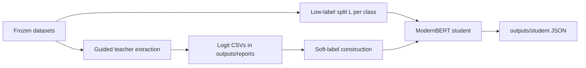

# Conflict-Aware Logit Purification for Multi-Teacher Distillation

Large language models (teachers) are queried once, with generation constrained to class letters (`A`, `B`, …). Their first-token logits are cached and reused. A small **ModernBERT-base** student is then trained on a few labeled examples per class (`L = 10` or `50`), using a mixture of cross-entropy on gold labels and KL distillation from teacher soft labels.

When several teachers disagree, a learned **conflict-aware router** (or a cheaper aggregation such as prior-and-scale alignment) builds one purified distribution per example. A **cascade** can also skip extra teacher queries on confident samples so the mean query cost stays near 1.4 teachers per example.

This repository includes the source, frozen dataset artifacts, teacher logit reports, and student result JSON used in the dissertation. Re-querying teachers or retraining the full grid is optional.

## Pipeline



1. Load a balanced HuggingFace artifact from `data/`.
2. Extract guided teacher logits (or reuse the CSVs already in `outputs/reports/`).
3. Subsample `L` labeled examples per class, split into student-train / calibration, and treat the rest as unlabeled for distillation.
4. Build soft labels (single teacher, mean, prior/scale alignment, cascade, router, …).
5. Train ModernBERT and write metrics JSON under `outputs/student/`.

## Repository layout

| Path | Role |
| --- | --- |
| `src/data/` | Dataset loaders and low-label subsampling |
| `src/teachers/` | LLM clients, verbalizer prompts, logit extraction |
| `src/student/` | ModernBERT student, KD loss, multi-teacher soft labels |
| `src/disagreement/` | Per-example disagreement features \(\phi(x)\) |
| `src/router/` | Linear/MLP router, oracle mixture, purification |
| `src/config.py` | Default `L`, seeds, student hyperparameters |
| `scripts/` | CLI entry points and GPU sweep shells |
| `tests/` | Unit tests (no live API calls in `test_*.py`) |
| `data/` | Frozen train/test artifacts (`large-test-v1`) |
| `outputs/reports/` | Teacher logit CSVs and analysis tables |
| `outputs/student/` | Per-run student metrics JSON |
| `outputs/figures/` | PDF figures |
| `vllm-server/` | Separate Python 3.12 project for local vLLM |
| `notebooks/explore_data.ipynb` | Quick look at datasets and splits |

## Requirements

- **Python 3.14** for the main project (see `.python-version`). Install with [uv](https://docs.astral.sh/uv/).
- A CUDA GPU for student training (`torch` is pulled from the PyTorch cu126 index in `pyproject.toml`).
- Optional: a second GPU environment for local teachers. vLLM does not support Python 3.14, so the server lives in `vllm-server/` on **Python 3.12**.

Main Python dependencies: `torch`, `transformers`, `datasets`, `openai`, `scikit-learn`, `scipy`, `matplotlib`, `tiktoken`.

## Setup

```bash
uv sync
cp .env.example .env   # fill in keys you actually use
chmod 600 .env
```

Include the Jupyter/pytest extra group if you want notebooks and tests:

```bash
uv sync --group dev
```

Verify the frozen artifacts and the default subsample grid:

```bash
uv run python scripts/verify_data.py
```

## Configuration

Copy `.env.example` to `.env`. Only set the keys for the backends you use. The file is gitignored.

| Variable | Used for |
| --- | --- |
| `OPENAI_API_KEY` | `gpt-4.1-mini`, `gpt-4o` (optional `OPENAI_BASE_URL` for a university proxy) |
| `OPENROUTER_API_KEY` | OpenRouter teachers |
| `RUNPOD_API_KEY` | Self-hosted RunPod vLLM |
| `OLLAMA_API_KEY` | Local Ollama (`ollama` is enough) |
| `VLLM_API_KEY`, `VLLM_BASE_URL` | Local vLLM client (must match `./start_vllm.sh`) |
| `VLLM_MODEL` | HuggingFace id served by vLLM |
| `HF_TOKEN` | Gated model downloads on the vLLM host |

Student training itself does not need API keys if the guided logit CSVs already exist.

## Datasets

All reported datasets are **class-balanced** HuggingFace `DatasetDict`s on disk. Training-row order is hashed (`sha256` in `metadata.json`) so cached teacher rows stay aligned with `dataset.train`.

| Name | Source | Classes | Train / test (per class) | Notes |
| --- | --- | --- | --- | --- |
| `ag_news` | `fancyzhx/ag_news` | 4 (World, Sports, Business, Sci/Tech) | 1500 / 1900 | News topic |
| `yahoo` | `mteb/yahoo_answers_topics` | 10 topics | 500 / 1000 | Highest class count |
| `amazon` | `vgaraujov/amazon_review_full` | 5 star ratings | 500 / 2000 | Primary ordinal task |
| `amazon3` | Grouped from `amazon` | negative / neutral / positive | 500 / 2000 | Robustness check; no new teacher queries |

`amazon3` maps 1–2 stars → negative, 3 → neutral, 4–5 → positive, then rebalances. Guided logits are **marginalised** from the Amazon-5 reports (`log` of summed softmax mass per group).

Low-label protocol (`src/data/subsampling.py`):

- Draw `L` labeled examples per class (`L ∈ {10, 50}` in the main tables).
- Hold out `cal_ratio = 0.3` of those labels for calibration / router fitting.
- Remaining training rows are unlabeled for distillation.
- Two gold demonstrations per class are reserved for teacher prompts and are included in the declared label set (prompt-inclusive protocol).

Default experiment seeds in `src/config.py`: `42, 123, 456, 789, 2024`. Core tables use the first three.

Rebuild larger test splits **without** re-querying teachers (only if you must regenerate artifacts):

```bash
uv run python scripts/rebuild_larger_test_sets.py
```

The rebuild stages all four datasets, then refuses to install unless every training-row identity is unchanged and every cached teacher row still matches its training label.

## Teacher logit extraction

Guided presets constrain the first generated token to the class verbalizers, so each row of the CSV has a full `logit_A … logit_<C>` vector and `floor_fraction = 0`.

Main teachers used in the dissertation:

| Preset | Model | Backend |
| --- | --- | --- |
| `qwen3.5-27b-vllm-guided` | `Qwen/Qwen3.5-27B` | local vLLM |
| `gemma4-26b-vllm-guided` | `google/gemma-4-26B-A4B-it` | local vLLM |
| `mistral-small-24b-vllm-guided` | `mistralai/Mistral-Small-3.2-24B-Instruct-2506` | local vLLM |

Reports already in the repo (no extraction needed to train students):

- `outputs/reports/{teacher}_{dataset}.csv`
- matching `*_summary.json`

To extract again (GPU + vLLM, slow and expensive):

```bash
cp .env.example .env   # set HF_TOKEN, VLLM_API_KEY, VLLM_MODEL
cd vllm-server && uv sync --python 3.12 && cd ..
./start_vllm.sh
# wait for "Application startup complete" in vllm.log

uv run python scripts/extract_logits.py \
  --teacher qwen3.5-27b-vllm-guided --dataset ag_news --report
```

`--limit N` extracts only the first `N` training rows (smoke test). Switch `VLLM_MODEL` and restart the server before changing teacher:

```bash
# .env
VLLM_MODEL=google/gemma-4-26B-A4B-it
# then: gemma4-26b-vllm-guided

# or
VLLM_MODEL=mistralai/Mistral-Small-3.2-24B-Instruct-2506
# then: mistral-small-24b-vllm-guided
```

Unguided (`*-vllm` without `-guided`) and cloud/Ollama presets exist in `src/teachers/llm.py` for diagnostics; dissertation students are trained from **guided** reports.

## Student training

Student: `answerdotai/ModernBERT-base`, 3 epochs, batch size 16, lr `2e-5`, max length 256, KD temperature \(\tau = 2\), mix \(\alpha = 0.5\) (CE + KL). Device is selected automatically (`src/student/model.py`).

**Supervised baseline** (CE only, no teacher):

```bash
uv run python scripts/train_student.py \
  --dataset ag_news --mode supervised \
  --labels-per-class 10 --seed 42
```

**Single-teacher KD:**

```bash
uv run python scripts/train_student.py \
  --dataset ag_news --mode kd \
  --teacher qwen3.5-27b-vllm-guided \
  --labels-per-class 10 --seed 42
```

**Multi-teacher KD** (no extra LLM calls; mixes cached logits):

```bash
uv run python scripts/train_student.py \
  --dataset ag_news --mode kd \
  --teacher multi-prior-scale-aligned-guided \
  --labels-per-class 10 --seed 42
```

Each run writes JSON to `outputs/student/` with dataset, method, `L`, seed, hyperparameters, split sizes, and test accuracy / F1.

### Soft-label methods (`--teacher`)

| Name | What it does |
| --- | --- |
| `qwen3.5-27b-vllm-guided` (and Gemma/Mistral) | Distill one guided teacher |
| `qwen-prior-matched-guided` | Recalibrate Qwen to the working-pool class prior |
| `multi-mean-guided` | Average teacher **logits** |
| `multi-probmean-guided` | Average teacher **probabilities** |
| `multi-entropy-guided` | Entropy-weighted mixture |
| `multi-prior-matched-guided` | Match the mixture to the class prior |
| `multi-scale-aligned-guided` | Align teacher confidence scales |
| `multi-prior-scale-aligned-guided` | Combined prior + scale alignment (main multi-teacher method) |
| `multi-cascade-guided` | Query extra teachers only when the first is uncertain; default ~1.4 queries/sample |
| `multi-uniform-budget-guided` | Same mean query budget, random extra queries (budget-matched baseline) |
| `multi-depth-matched-random-guided` | Random allocation with the same depth profile as cascade |
| `oracle-guided` | Ground-truth gating (upper bound, uses labels) |
| `multi-router-linear-guided` / `multi-router-mlp-guided` | Learned mixture from disagreement features \(\phi(x)\) |

Cascade / budget flags:

```bash
uv run python scripts/train_student.py --dataset ag_news --mode kd \
  --teacher multi-cascade-guided --cascade-target-queries 1.4 \
  --cascade-order qwen-first --labels-per-class 10 --seed 42

uv run python scripts/train_student.py --dataset ag_news --mode kd \
  --teacher multi-uniform-budget-guided --uniform-target-queries 1.4 \
  --labels-per-class 10 --seed 42
```

Assumed-prior misspecification (pool stays balanced; only the **assumed** prior is skewed):

```bash
uv run python scripts/train_student.py --dataset ag_news --mode kd \
  --teacher multi-prior-scale-aligned-guided \
  --prior-condition mild --prior-dominant-class 0 \
  --labels-per-class 10 --seed 42
```

`--dry-run` builds and checks soft targets without loading ModernBERT.

## Reproducing dissertation tables

Cached student JSON is already under `outputs/student/`. Analysis scripts are read-only over those directories and write markdown/JSON into `outputs/reports/`.

| Goal | Train (GPU, optional) | Analyse |
| --- | --- | --- |
| Core 3-seed grid (4 datasets × 2 `L` × 8 methods) | `scripts/run_prompt_inclusive_core_3seed_gpu.sh` | `uv run python scripts/analyse_prompt_inclusive_core_students.py` |
| Extra baselines (entropy, cascade, routers, …) | `scripts/run_prompt_inclusive_baselines_3seed_gpu.sh` | `uv run python scripts/analyse_prompt_inclusive_baselines_students.py` |
| Cascade vs uniform at 1.4 queries/sample | `scripts/run_rq2_matched_budget_gpu.sh` | `uv run python scripts/analyse_rq2_matched_students.py` |
| Depth-matched random allocation | `scripts/run_rq2_depth_matched_random_gpu.sh` | `uv run python scripts/analyse_rq2_depth_matched_random.py` |
| Prior misspecification | `scripts/run_student_prior_misspecification_gpu.sh` | `uv run python scripts/analyse_student_prior_misspecification.py` |
| Amazon-3 source-prior transfer | `scripts/run_amazon3_source_prior_gpu.sh` | `uv run python scripts/analyse_amazon3_source_prior.py` |

GPU shells are **resumable**: they skip cells whose JSON already looks valid. They do not query teachers.

Quick comparison of whatever JSON sits in `outputs/student/` for one seed:

```bash
uv run python scripts/compare_kd_results.py --seed 42
```

A smaller supervised + single-teacher grid:

```bash
./scripts/run_student_grid.sh ag_news
```

## Other utilities

| Script | Purpose |
| --- | --- |
| `scripts/plot_logits.py` | Confusion / confidence / reliability PDFs for one teacher CSV |
| `scripts/analyse_vllm_logits.py` | Guided vs unguided vLLM figures |
| `scripts/analyse_disagreement.py` | Teacher disagreement correlations |
| `scripts/build_ag_news.py`, `build_yahoo.py`, `build_amazon.py` | Build a dataset artifact from HuggingFace |
| `scripts/build_amazon3.py` | Group Amazon-5 → Amazon-3 and derive grouped logits |
| `scripts/export_extraction_report.py` | CSV/JSON extraction reports |
| `scripts/check_verbalizer_tokens.py` | Confirm class letters are single tokenizer tokens |

## Tests

```bash
uv sync --group dev
uv run pytest tests/ -q
```

`tests/test_*.py` cover loaders, identity hashes, soft-label builders, router math, and analysis helpers. `tests/demo_extraction*.py` hit live APIs and are not part of the default pytest suite.

## Outputs

- `outputs/reports/*.csv` — per-row teacher logits (`sample_idx`, gold label, `logit_A` …).
- `outputs/student/**/*.json` — one file per training cell.
- `outputs/reports/*.md` / `*.json` — aggregated tables used in the dissertation.
- `outputs/figures/` — PDF plots.
- `cache/` — optional raw logit cache (gitignored). Extraction reports under `outputs/reports/` are what student training reads.

Do not commit `.env`. Do not vendor `.venv/` or `vllm-server/.venv/`.
