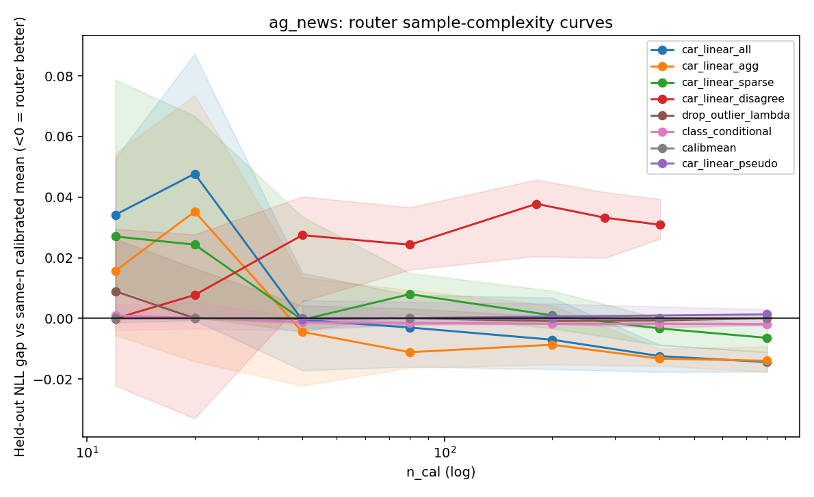
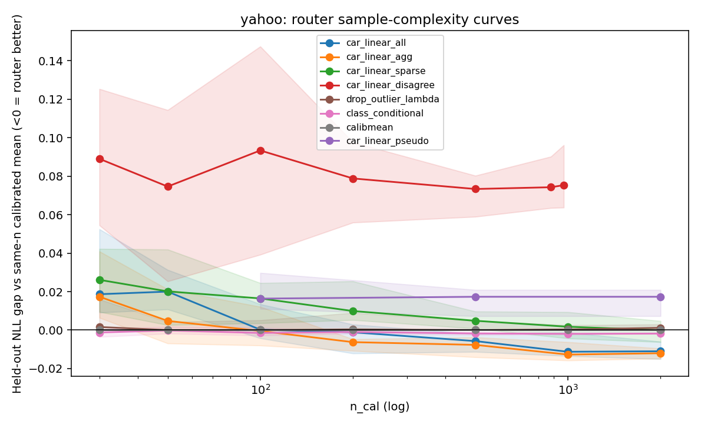
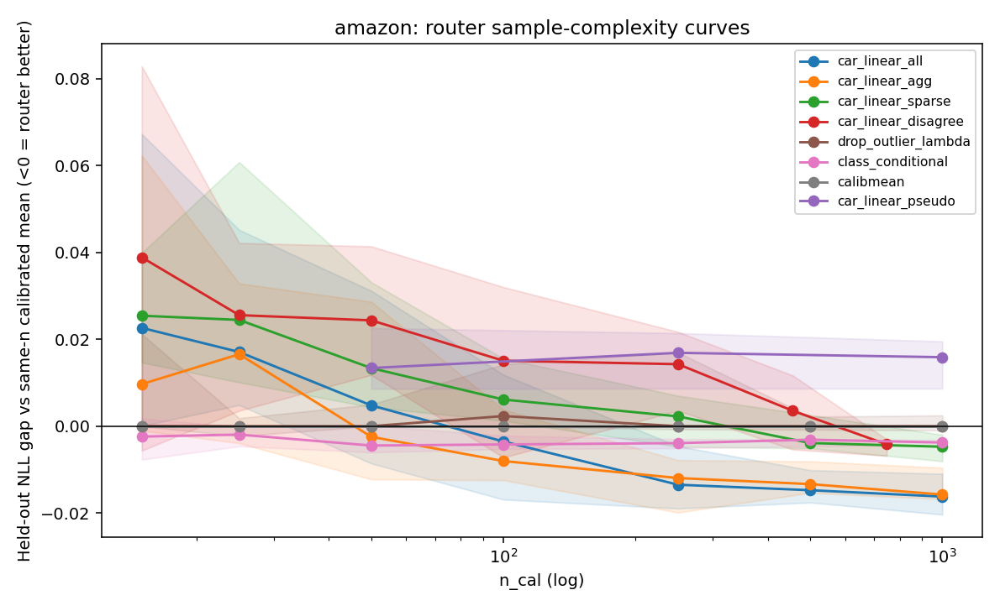

# Router sample complexity

Proxy learning curves on cached teacher logits. Evaluation is always the
same stratified 20% holdout per seed; n_cal is drawn from the remaining 80%.
A variant *survives* Stage A if median OOS NLL beats calibrated prob-mean
without collapsing entropy (H >= H_calibmean - 0.05).

Good-router n* requires all of: NLL gap p10 < 0, entropy-ok rate >= 80%, oracle-gap-closed p10 >= 50%,
gate-pass rate >= 80%.

## ag_news

### Stage A — learnable ceiling (80/20)

| variant | NLL gap median | survive rate | oracle-gap closed | survives |
|---|---:|---:|---:|---|
| v2_linear_all | -0.0218 | 40% | 0.00 | False |
| v2_mlp_all | -0.0231 | 100% | 0.00 | True |
| v2_linear_agg | -0.0185 | 40% | 0.00 | False |
| car_linear_all | -0.0225 | 100% | 0.00 | True |
| car_mlp_all | -0.0253 | 100% | 0.00 | True |
| car_linear_agg | -0.0199 | 100% | 0.00 | True |
| car_linear_sparse | -0.0090 | 100% | 0.00 | True |
| car_linear_disagree | -0.0090 | 100% | 0.00 | True |
| car_linear_pseudo | +0.0059 | 0% | 0.00 | False |
| drop_outlier_lambda | -0.0021 | 80% | 0.00 | True |
| class_conditional | -0.0017 | 100% | 0.00 | True |
| car_linear_all_insample | -0.0235 | 100% | 0.00 | True |

### n*

- n*_τ (calibrated mean saturates): `40`
- `car_linear_all`: n*_proxy=None n*_nll=40 (Stage A survives=True; ignoring ceiling=None)
- `car_linear_agg`: n*_proxy=None n*_nll=40 (Stage A survives=True; ignoring ceiling=None)
- `car_linear_sparse`: n*_proxy=None n*_nll=40 (Stage A survives=True; ignoring ceiling=None)
- `car_linear_disagree`: n*_proxy=None n*_nll=12 (Stage A survives=True; ignoring ceiling=None)
- `drop_outlier_lambda`: n*_proxy=None n*_nll=40 (Stage A survives=True; ignoring ceiling=None)
- `class_conditional`: n*_proxy=None n*_nll=12 (Stage A survives=True; ignoring ceiling=None)
- `car_linear_pseudo`: n*_proxy=None n*_nll=None (Stage A survives=False; ignoring ceiling=None)

## yahoo

### Stage A — learnable ceiling (80/20)

| variant | NLL gap median | survive rate | oracle-gap closed | survives |
|---|---:|---:|---:|---|
| v2_linear_all | +0.0051 | 0% | 0.00 | False |
| v2_mlp_all | -0.0084 | 0% | 0.00 | False |
| v2_linear_agg | -0.0034 | 0% | 0.00 | False |
| car_linear_all | -0.0170 | 100% | 0.00 | True |
| car_mlp_all | -0.0189 | 0% | 0.00 | False |
| car_linear_agg | -0.0199 | 100% | 0.00 | True |
| car_linear_sparse | -0.0027 | 80% | 0.00 | True |
| car_linear_disagree | -0.0027 | 80% | 0.00 | True |
| car_linear_pseudo | +0.0243 | 0% | 0.00 | False |
| drop_outlier_lambda | +0.0014 | 0% | 0.00 | False |
| class_conditional | -0.0017 | 100% | 0.00 | True |
| car_linear_all_insample | -0.0211 | 100% | 0.00 | True |

### n*

- n*_τ (calibrated mean saturates): `30`
- `car_linear_all`: n*_proxy=None n*_nll=500 (Stage A survives=True; ignoring ceiling=None)
- `car_linear_agg`: n*_proxy=None n*_nll=50 (Stage A survives=True; ignoring ceiling=None)
- `car_linear_sparse`: n*_proxy=None n*_nll=1000 (Stage A survives=True; ignoring ceiling=None)
- `car_linear_disagree`: n*_proxy=None n*_nll=None (Stage A survives=True; ignoring ceiling=None)
- `drop_outlier_lambda`: n*_proxy=None n*_nll=None (Stage A survives=False; ignoring ceiling=None)
- `class_conditional`: n*_proxy=None n*_nll=30 (Stage A survives=True; ignoring ceiling=None)
- `car_linear_pseudo`: n*_proxy=None n*_nll=None (Stage A survives=False; ignoring ceiling=None)

## amazon

### Stage A — learnable ceiling (80/20)

| variant | NLL gap median | survive rate | oracle-gap closed | survives |
|---|---:|---:|---:|---|
| v2_linear_all | -0.0047 | 0% | 0.06 | False |
| v2_mlp_all | -0.0166 | 0% | 0.20 | False |
| v2_linear_agg | -0.0011 | 0% | 0.01 | False |
| car_linear_all | -0.0250 | 100% | 0.32 | True |
| car_mlp_all | -0.0210 | 100% | 0.25 | True |
| car_linear_agg | -0.0217 | 100% | 0.30 | True |
| car_linear_sparse | -0.0039 | 100% | 0.06 | True |
| car_linear_disagree | -0.0039 | 100% | 0.06 | True |
| car_linear_pseudo | +0.0218 | 0% | -0.27 | False |
| drop_outlier_lambda | +0.0000 | 20% | 0.00 | False |
| class_conditional | -0.0036 | 100% | 0.00 | True |
| car_linear_all_insample | -0.0276 | 100% | 0.36 | True |

### n*

- n*_τ (calibrated mean saturates): `15`
- `car_linear_all`: n*_proxy=None n*_nll=250 (Stage A survives=True; ignoring ceiling=None)
- `car_linear_agg`: n*_proxy=None n*_nll=250 (Stage A survives=True; ignoring ceiling=None)
- `car_linear_sparse`: n*_proxy=None n*_nll=250 (Stage A survives=True; ignoring ceiling=None)
- `car_linear_disagree`: n*_proxy=None n*_nll=456 (Stage A survives=True; ignoring ceiling=None)
- `drop_outlier_lambda`: n*_proxy=None n*_nll=None (Stage A survives=False; ignoring ceiling=None)
- `class_conditional`: n*_proxy=None n*_nll=15 (Stage A survives=True; ignoring ceiling=None)
- `car_linear_pseudo`: n*_proxy=None n*_nll=None (Stage A survives=False; ignoring ceiling=None)

## How to read n*

- **n*_proxy** (strict): close ≥50% of the soft-oracle NLL gap. **None everywhere** — even a full-pool φ-router closes at most 36% (Amazon). The unlearnable oracle uses `p_i(y_true)`, which is not a function of φ(x).
- **n*_nll**: smallest n_cal whose 10th-percentile NLL beats same-n calibrated mean, with entropy floor and NLL gate. This is the practical "how many labels to beat calibration-then-average".
- **n*_τ**: labels to stabilize per-teacher temperatures. 15–40 total, i.e. the budget *is* enough to calibrate.

Oracle-gap-closed ≈ 0 on AG News / Yahoo because after temperature scaling the calibrated mean already matches the raw-logit oracle on NLL; residual routing headroom only shows up on Amazon (0.32).

## Δn* (sample-efficiency variants vs CAR linear-all)

| variant | AG n*_nll | Yahoo n*_nll | Amazon n*_nll |
|---|---:|---:|---:|
| car_linear_all (reference) | 40 | 500 | 250 |
| car_linear_agg (5 features) | 40 | **50** | 250 |
| car_linear_disagree (active) | **12** | inf | 456 |
| class_conditional (K×C) | **12** | **30** | **15** |
| car_linear_pseudo | inf | inf | inf |
| v2_linear_all | Stage A fail | Stage A fail | Stage A fail |

Class-conditional weights are the most sample-efficient proxy method (n*_nll ≈ n*_τ) but the NLL gain is tiny (≤0.004). Disagreement-only labelling helps on AG News (4×). Majority pseudo-labels never survive Stage A. Shrinking φ to 5 aggregate features cuts Yahoo n*_nll 10× (500 → 50).

## Stage E — student confirmation (ModernBERT, L=10 CE, isolated router labels)

Paired McNemar vs reused `multi-mean-guided` L=10 3-seed runs: [mcnemar.md](../../student/router_sample_complexity_v1/mcnemar.md).

Full-pool `car_linear_all` mean Δacc vs logit-mean:

- AG News: **+1.17 pp** (seeds +1.50 / +1.03 / +0.99; all McNemar p < 0.001). Also slightly above calibrated mean.
- Yahoo: **−1.69 pp** (all seeds lose; p < 0.001).
- Amazon: **−2.48 pp** (all seeds lose; p < 0.001).

n*_nll student transfer is unstable on AG (one seed −1.25 pp) and negative on Yahoo/Amazon. v2 declared L=10 routers (current operating point, labels stolen from CE) do not consistently beat the mean.

**n*_student** for a router that beats naive averaging on the held-out test set is therefore **finite only on AG News, and only with essentially the full train pool**; it is **infinite** on Yahoo and Amazon in this teacher committee. Proxy NLL learnability does not imply distillation usefulness — matching the plan's prediction.

Existing L=10 v2 runs remain the negative control: the 12–30 label regime is far below n*_nll except for class-conditional / AG disagreement sampling, and even those do not transfer to the student.

